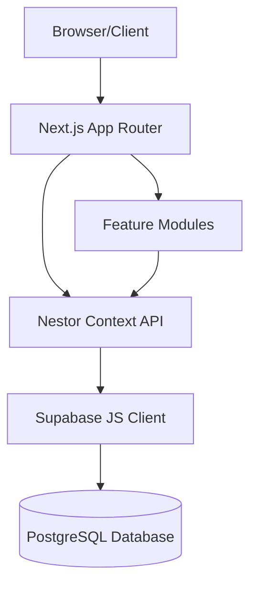

# System Architecture

Nestor is built using a modern, decoupled architecture centered around Next.js App Router, modular feature directories, and a robust global state context.

> Looking for the future/aspirational product direction (Activity normalization, Universal
> Timeline, AI Layer, external Integrations, etc.)? That's a separate, explicitly-not-yet-built
> vision — see [../VISION.md](../VISION.md). Everything below this line describes what actually
> exists in the codebase today. For the full engineering-reference version of this project
> (modules, coding standards, roadmap, decision history, glossary), see [brain.md](brain.md).

## High-Level Diagram



## Directory Structure

Nestor follows a feature-driven folder structure inside the `src` directory. This approach ensures that components, types, and logic related to a specific domain are kept closely co-located. The Next.js App Router root is the top-level `app/` directory (not `src/app/` — an earlier duplicate route tree under `src/app/` was removed during v1 stabilization; see [changelog.md](changelog.md) Phase 1).

```text
app/                      # Next.js App Router root: layout.tsx, page.tsx
src/
├── features/             # Domain-specific modules, one folder per feature
│   ├── auth/              # Login page
│   ├── dashboard/          # Overview cards, unified activity feed, quick search
│   ├── task/               # Task log: cards, timers, filtering
│   ├── ticket/             # Ticket log: CRUD, per-user work logs
│   ├── oem-case/           # OEM case log: CRUD
│   ├── shift-roster/       # Team shift roster grid, bulk assign, change requests
│   ├── calendar/           # Personal calendar: own shift view/request
│   ├── password-vault/     # Team + Personal credential vaults (see auth.md for encryption)
│   ├── reports/            # Client-side report aggregation/export
│   ├── settings/           # Registries (products/categories/etc.), appearance, vault security
│   └── user-management/    # Admin-only user CRUD via Supabase RPCs
├── shared/                # Cross-feature reusable code
│   ├── components/
│   │   ├── layout/         # AppShell (sidebar/topbar navigation)
│   │   └── ui/              # Generic primitives (CustomSelect, TimePicker, toasts, modals)
│   ├── context/            # nestor-context.tsx — the single global state provider
│   ├── lib/                 # supabase.ts (client), vault-crypto.ts (encryption), theme-utils.ts
│   └── styles/              # tokens.css — design tokens
```

## Global State Management

Nestor utilizes a unified React Context (`NestorContext`) rather than Redux or Zustand. This Context acts as the central brain of the application.

### Why Context API?
1. **Simplicity**: No boilerplate overhead compared to external libraries.
2. **Centralized Data Fetching**: The context provider wraps the application and performs initial data fetches from Supabase on mount.
3. **Optimistic Updates**: The context functions (e.g., `saveRosterChanges`, `addTicket`) immediately update the local React state for a snappy UI, while asynchronously syncing with Supabase in the background. Failures now surface via a toast system (see `shared/components/ui/toast.tsx`) rather than failing silently.

## The App Shell Pattern

Nestor utilizes an `AppShell` layout component that wraps all authenticated pages. The App Shell provides:
- The sticky sidebar navigation for desktop.
- The sticky top mobile navbar.
- Z-index management and layout bounding to ensure the central workspace is always perfectly scrollable.

## Database & Security

The database schema, RLS policies, and admin RPCs are consolidated in a single file,
`supabase_schema.sql`, at the repo root — see [database.md](database.md) for the table-by-table
breakdown and [auth.md](auth.md) for authentication, authorization, and the Password Vault's
encryption architecture in detail.
