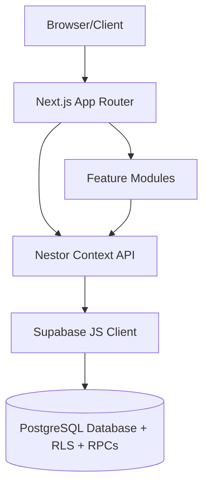

# Nestor — Project Brain

> **This is the permanent memory and architecture document for this project.** Read this file
> first, before touching any code. It exists so a new AI coding agent (or human engineer) can
> understand the project immediately without asking questions that are already answered here.
>
> **This document must be updated whenever architecture changes — before the code change, not
> after.** If you make an architectural decision, add an entry to
> [decisions.md](decisions.md) and update the relevant section here in the same change.
>
> This file explains **why** things are the way they are, not just what exists. Companion docs
> (each focused, none duplicating this one's synthesis): [architecture.md](architecture.md),
> [database.md](database.md), [auth.md](auth.md), [api.md](api.md), [decisions.md](decisions.md),
> [roadmap.md](roadmap.md), [changelog.md](changelog.md), [setup.md](setup.md), and at the repo
> root: [../VISION.md](../VISION.md) (aspirational future, explicitly not built) and
> [../DESIGN.md](../DESIGN.md) (visual design philosophy).

---

# 1. Project Overview

**Project name**: Nestor (internally also labeled "PWIS" — Personal Work Intelligence System —
in the login screen and browser tab title).

**Purpose**: An internal operations and workforce management platform for a security/IT
operations team (the product catalog visible throughout the app — Arcon PAM, Kaspersky AV/EDR/XDR,
Symantec AV/DLP, Trellix AV/DLP, GTB DLP, Trend Vision AV, enLight DAM/PAM/WAF — strongly implies
this is built for a Managed Security Services (MSS) or similar security-operations team). It
centralizes shift rostering, task/time tracking, IT ticketing, OEM vendor case tracking, and
credential (password) management into one workspace, replacing scattered Excel sheets, notes, and
separate portals.

**Vision** (aspirational, not built — see [../VISION.md](../VISION.md)): evolve into an
AI-powered operations workspace where every work item (ticket, task, OEM case, meeting, etc.)
becomes a normalized "Activity," with a universal timeline, universal search, and an AI layer that
reasons over Activities instead of module-specific data. **None of this exists today.** Don't
assume any of it when reading code or planning work — see section 6 for the explicit gap.

**Long-term goal**: see [roadmap.md](roadmap.md) for what's actually prioritized next (distinct
from the full VISION.md aspiration, which isn't scoped into concrete work yet).

**Target users**: Internal team members (engineers/analysts) and admins/managers at a security
operations team. Two roles exist today: `admin` and `member` (see section 8).

**Problems being solved**: (1) shift roster management with visual conflict tracking and a
request/approval workflow; (2) daily task and time tracking; (3) IT/operational ticket logging
with per-user work-log history; (4) OEM vendor support case tracking; (5) secure, encrypted
credential storage for both team-shared and personal secrets; (6) report generation/export across
all of the above.

---

# 2. Core Philosophy

- **Single source of truth, but two of them, not one.** Database schema/RLS/RPCs:
  `supabase_schema.sql` (see [database.md](database.md)). App state/business logic:
  `src/shared/context/nestor-context.tsx`, a single global React Context (`NestorContext`) — see
  section 3. There is deliberately no third place that duplicates either.
- **NOT Activity Normalization.** This is the single most important thing to get right when
  reading this codebase: the vision document describes a unified `activities` table with every
  work item normalized into it. **The actual implementation has no such thing.** Every module
  (tasks, tickets, OEM cases, shift roster, vault) has its own dedicated table and its own
  dedicated React feature folder. See section 6 for the full explanation of this gap.
  Never assume an "Activity Service" exists to plug into — it doesn't.
- **Enterprise-first, but backend-light.** Row Level Security is the *actual* security boundary
  (see section 3) — not a nice-to-have layered on top of a trusted backend, because there is no
  backend. This inverts the usual "backend owns business logic" enterprise philosophy: here, the
  database (RLS policies + `SECURITY DEFINER` RPCs) is the closest thing to a backend, and it must
  be trusted as the actual authority, not the browser-side React code.
- **Modular, feature-driven design.** One folder per domain under `src/features/`; nothing shared
  across features except through `src/shared/`. No feature folder imports directly from another
  feature folder.
- **No duplicated logic** — enforced in practice, not just aspiration. Examples already
  discovered and fixed during development: a duplicate dead route tree (`src/app/` vs `app/`,
  removed), a duplicate color-mapping utility (`category-colors.ts`, deleted — zero importers),
  three divergent copies of the same SQL schema (consolidated into one file). See
  [changelog.md](changelog.md) Phase 0/1.
- **UI stays thin.** Feature components render and call context functions; they don't contain
  business logic, Supabase calls, or encryption logic directly (the Password Vault module calls
  `useNestor()` functions like `addVaultEntry`; it never calls `supabase.from(...)` or
  `crypto.subtle` itself).
- **Fail visibly, not silently.** Every write path surfaces failures via a toast system
  (`src/shared/components/ui/toast.tsx`) with the real underlying error message — added
  specifically because early versions of this app failed Supabase writes silently while showing
  optimistic local UI state, which masked a real data-loss bug for an unknown period (see
  [changelog.md](changelog.md) Phase 3).

---

# 3. Architecture Overview

**Frontend**: Next.js 16 (App Router, Turbopack), React 19, TypeScript 5 (strict mode), Tailwind
CSS 4, Framer Motion for animation, Lucide React for icons, `react-hook-form` + `zod` for form
validation, `recharts` for dashboard charts, `jspdf`/`jspdf-autotable` for PDF report export.

**Backend**: **There is none.** No Next.js API routes (`app/api/` doesn't exist), no server-side
Supabase client, no Service Role key usage anywhere. Every data operation is either (a) a direct
Supabase table call from the browser, gated by RLS, or (b) a call to a `SECURITY DEFINER` Postgres
RPC for the handful of operations that need elevated privilege (user creation/deletion/password
reset — RLS can't protect `auth.users` since it isn't one of this app's own tables). Full contract
for both in [api.md](api.md).

**Database**: PostgreSQL via Supabase. Schema, RLS, RPCs, and privilege grants are all defined in
one file, [../supabase_schema.sql](../supabase_schema.sql) — idempotent, re-runnable, the single
source of truth. Full table-by-table breakdown in [database.md](database.md).

**Authentication**: Supabase Auth (email + password only — no OAuth/SSO, no self-service "forgot
password" flow in the UI today; only an admin-triggered reset via `admin_reset_password`, or a
first-login mandatory password-set flow via `complete_initial_password`). See [auth.md](auth.md).

**Authorization**: Two roles (`admin`/`member`) on `profiles.role`, checked both in application
code and — more importantly — in Supabase RLS policies, which are the real enforcement boundary.
See section 8 and [auth.md](auth.md).

**Storage**: **Not used.** No Supabase Storage buckets, no file upload/attachment feature exists
anywhere in the app.

**AI**: **Not implemented.** Vision-only (see [../VISION.md](../VISION.md) "AI Layer"). No AI
SDK dependency, no AI-related code anywhere in `src/`.

**External Integrations**: **None implemented.** No connector code, no webhook/OAuth
integrations. A Ticket Log ↔ Helpdesk360 integration has been discussed and deferred — see
[roadmap.md](roadmap.md).

**Global State**: `NestorContext` (`src/shared/context/nestor-context.tsx`) — a single React
Context wrapping the whole authenticated app, holding essentially all application state (tasks,
tickets, OEM cases, roster, vault, settings registries, auth session) and every mutating function.
Chosen over Redux/Zustand for simplicity; centralizes Supabase reads on mount and provides
optimistic-update write functions.

Directory structure and the App Shell layout pattern are documented in full in
[architecture.md](architecture.md) — not repeated here to avoid drift between two copies.

---

# 4. Current Modules

Each module is a folder under `src/features/`. Modules never import from one another directly —
all cross-module data flows through `NestorContext`.

### Dashboard (`features/dashboard`)
- **Purpose**: landing page answering "what needs attention, what happened today."
- **Responsibilities**: overview stat cards, a derived (not persisted) "unified activity" feed
  merging tasks + tickets for display, a local quick-search widget, charts (via `recharts`).
- **Features**: click-through deep links into Tasks/Tickets/OEM Cases.
- **Dependencies**: reads `tasks`/`tickets`/`oemCases` from context; does not own any data.
- **Future roadmap**: this is the closest existing analog to VISION.md's "Universal Timeline" —
  but it's an ad hoc, render-time merge of two tables, not a real normalized/persisted/searchable
  entity. See section 6.

### Task Log (`features/task`)
- **Purpose**: personal daily task and time tracking.
- **Responsibilities**: CRUD on `tasks`; Play/Pause timer sessions logged into `sessions[]`.
- **Features**: categories (Meeting/Learning/Operations/Automation/Documentation/Health
  Check/Personal/Research, configurable in Settings), tags, notes, status
  (pending/in-progress/completed).
- **Dependencies**: `tasks` table, owner-scoped RLS.
- **Future roadmap**: none currently planned.

### Ticket Log (`features/ticket`)
- **Purpose**: IT/operational support ticket tracking.
- **Responsibilities**: CRUD on `tickets`; per-user work-log history (`ticket_work_logs` — a
  ticket can accumulate one log entry per person who worked on it, not just one "current" status).
- **Features**: priority (P1–P6), status, product, customer info, comments (JSONB).
- **Dependencies**: `tickets`, `ticket_work_logs` tables.
- **Future roadmap**: Helpdesk360 integration for auto-import/sync instead of manual entry — see
  [roadmap.md](roadmap.md).

### OEM Case Log (`features/oem-case`)
- **Purpose**: tracking support cases raised with OEM security vendors (the "OEM" here means
  Original Equipment Manufacturer — i.e. the security product vendor, e.g. Kaspersky, Trellix,
  Symantec — not a customer; see Glossary section 20).
- **Responsibilities**: CRUD on `oem_cases`, a centralized (not owner-scoped) team log.
- **Features**: product/category, case type, priority, status update, closure tracking.
- **Dependencies**: `oem_cases` table only.
- **Future roadmap**: none currently planned.

### Shift Roster (`features/shift-roster`)
- **Purpose**: team-wide shift assignment grid.
- **Responsibilities**: assign/bulk-assign shifts, publish roster changes, review member-submitted
  change requests.
- **Features**: roster membership is **entirely derived from User Management** (active
  `profiles`) — there is no separate add/remove-member concept (see [decisions.md](decisions.md)
  ADR-002). A "Change Requests" tab handles shift-change approvals (see Calendar below).
- **Dependencies**: `roster_assignments`, `shift_requests`, `profiles` (for membership), and
  `shift_presets` (currently in-memory/default only — see section 16 known issues).
- **Future roadmap**: persist `shift_presets` to Supabase — a `shift_presets` table already exists
  in the connected project but isn't wired up (see section 16).

### Calendar (`features/calendar`)
- **Purpose**: an individual user's personal view of their own shift schedule, and where they
  submit a shift-change request.
- **Responsibilities**: reads the same `roster_assignments` data as Shift Roster, scoped to the
  logged-in user; submits `shift_requests`.
- **Features**: month/day views, request-a-different-shift flow (admins update directly instead
  of requesting — see `assignRosterShift` vs `submitShiftRequest` in `nestor-context.tsx`).
- **Dependencies**: `roster_assignments`, `shift_requests`. When Supabase isn't configured (local
  mode), falls back to a separate in-memory `shiftAssignments` state — this is intentional
  fallback behavior, not a bug (confirmed by design, not a missing sync — see
  [decisions.md](decisions.md) discussion referenced in changelog Phase 2).
- **Future roadmap**: none currently planned beyond the `calendar_assignments` table
  investigation in section 16.

### Password Vault (`features/password-vault`)
- **Purpose**: secure credential storage — a Team (Organization) Vault and a Personal Vault.
- **Responsibilities**: full CRUD with real client-side AES-256-GCM encryption; admin-only writes
  on the Team Vault; a Recovery Kit for forgotten-passphrase recovery.
- **Features**: Product Group → Client Setup → Credential Set tree (Team Vault); flat list
  (Personal Vault); master password / personal PIN management; Recovery Kit setup/recovery;
  destructive Reset & Wipe last resort.
- **Dependencies**: `vault_products`, `vault_clients`, `vault_entries`, `personal_vault`,
  `vault_key_wraps`. Full architecture in [auth.md](auth.md) "Password Vault Encryption" and
  section 9 below.
- **Future roadmap**: see [roadmap.md](roadmap.md) (audit-log investigation, one-time
  re-encryption pass for any remaining legacy plaintext rows).

### Reports (`features/reports`)
- **Purpose**: build and export operational reports (tickets/tasks/shifts/meetings/learning) over
  a selected period.
- **Responsibilities**: client-side aggregation only — no persisted report history, no saved
  reports table (explicitly declined — see [decisions.md](decisions.md) ADR-010).
- **Features**: three real export formats — CSV, HTML, and a true one-click PDF download (via
  `jsPDF`, not a print-dialog).
- **Dependencies**: reads `tasks`/`tickets`/`roster_assignments`/`shift_presets` from context;
  owns no data itself.
- **Future roadmap**: none currently planned (this was explicitly closed out — see ADR-010).

### Settings (`features/settings`)
- **Purpose**: configuration registries and account preferences.
- **Responsibilities**: manage dropdown registries (products, categories, product categories,
  case types, status updates, team members), username, font family (appearance), and — admin-only
  — the Team Vault master password / Recovery Kit ("Password Vault Security" section).
- **Dependencies**: mostly client-state-only registries (not all persisted to Supabase — see
  section 16); the vault-security section calls the same context functions as the vault module.
- **Future roadmap**: none currently planned.

### User Management (`features/user-management`)
- **Purpose**: admin-only user administration.
- **Responsibilities**: create/reset-password/delete users and update employee IDs, entirely via
  the RPCs in [api.md](api.md) (never direct table writes to `auth.users`, which RLS can't
  protect anyway).
- **Dependencies**: `profiles` table (read), the five admin RPCs.
- **Future roadmap**: none currently planned.

### Auth (`features/auth`)
- **Purpose**: the login page. Email + password only, via `supabase.auth.signInWithPassword`.
- **Future roadmap**: MFA/SSO listed in `auth.md` "Future Enhancements," not started.

### NOT a module: Knowledge Base, AI
Both appear in the vision (and in the section template used to write this document) but **do not
exist in this codebase in any form** — no folder, no table, no UI, no code. Don't reference them
as if they're partially built.

---

# 5. Database Documentation

Full column-by-column, RLS-by-RLS detail lives in [database.md](database.md) — this section is
the synthesis, not a duplicate.

**Normalization strategy**: traditional per-domain relational design — one dedicated table per
feature (`tasks`, `tickets`, `oem_cases`, etc.), each with its own columns shaped for that
feature's exact needs, related via conventional foreign keys where needed (e.g.
`ticket_work_logs.ticket_id → tickets.id`, `vault_entries.product_id → vault_products.id`).
**This is deliberately not the "everything is one normalized Activity" model described in
VISION.md** — see section 6 for why that's a separate, unbuilt design.

**Tables** (11 total; see [database.md](database.md) for full column lists):
`profiles`, `tasks`, `tickets`, `ticket_work_logs`, `oem_cases`, `vault_products`, `vault_clients`,
`vault_entries`, `personal_vault`, `vault_key_wraps`, `roster_assignments`, `shift_requests`.

**Why each table exists** (one line, expanded in database.md): `profiles` extends
`auth.users` with role/status/employee info; `tasks`/`tickets`/`oem_cases` are the three core
work-logging domains; `ticket_work_logs` exists because a ticket needs *per-person* history, not
just a single mutable "my work" field; the five vault tables implement a tree structure
(products→clients→entries) plus personal entries plus the Recovery Kit's key-wrap storage;
`roster_assignments`/`shift_requests` implement the shift scheduling + change-request workflow.

**Important caveat — schema drift**: the connected Supabase project has, at various points,
turned out to have a different real column set than `supabase_schema.sql`'s `CREATE TABLE`
statements assumed (see [decisions.md](decisions.md) ADR-012 for the full incident list). The
practical rule this produced: **every column addition must be a defensive
`ALTER TABLE ... ADD COLUMN IF NOT EXISTS`, never assumed to already exist just because a
`CREATE TABLE IF NOT EXISTS` defines it.**

**Also present in the connected project, but unused by this app**: `shift_presets`,
`roster_members`, `calendar_assignments`, `security_audit_log`. None of these were created by this
app's schema history; their origin is unknown. See section 16 and [roadmap.md](roadmap.md).

---

# 6. Activity Normalization

**This section is intentionally short, because the concept is intentionally not implemented.**

VISION.md describes a design where every work item (ticket, task, OEM case, meeting, password
request, etc.) becomes a normalized `Activity` record with common fields (id, type, owner, title,
status, priority, tags, timestamps) plus a `metadata` JSONB blob for module-specific fields — and
everything downstream (timeline, search, reporting, AI) reads from that one table.

**None of this exists.** There is no `activities` table. There is no Activity Service. Each module
owns its own table with its own shape (section 5). The closest existing analog is
`dashboard-overview.tsx`'s `timelineActivities` — a `useMemo`-derived array built at render time by
merging the already-loaded `tasks` and `tickets` arrays for display in the dashboard's activity
feed. It is:
- **Not persisted** — it's recomputed on every render from data already in memory.
- **Not searchable as a distinct entity** — the dashboard's quick-search filters the same
  in-memory `tasks`/`tickets`/`oemCases` arrays directly, not a unified index.
- **Not used by Reports, the AI layer (which doesn't exist), or anything else** — it's purely a
  dashboard display convenience.

If Activity Normalization is ever actually built, it is a genuine data-model migration (new table,
migrate every existing module's rows into it or build a sync layer, rewrite every module's read
path), not an additive feature — treat it as a major project requiring its own design pass and an
ADR in [decisions.md](decisions.md), not something to bolt on incrementally. See
[roadmap.md](roadmap.md) "Long term."

---

# 7. Authentication

- **Provider**: Supabase Auth exclusively. No custom auth code, no other provider.
- **Flow**: email + password via `supabase.auth.signInWithPassword` (`features/auth/login-page.tsx`).
- **JWT/Sessions**: handled entirely by `@supabase/supabase-js`; `NestorContext` listens for
  auth-state changes and hydrates `user`/`role`/`status` from the `profiles` table on session
  start.
- **Password Reset**: **no self-service flow** — there is no "forgot password" link or
  `resetPasswordForEmail` call anywhere in the UI. The only paths are: (a) an admin resets a
  user's password via `admin_reset_password` (forces the target back to `'pending'` status), or
  (b) a brand-new user completes their first login via `complete_initial_password`. See
  [api.md](api.md) for both.
- **Current flow in full**: sign in → `NestorContext` loads `profiles` row → if `status ===
  'pending'`, the app shows a mandatory `ChangePasswordView` (calls `complete_initial_password`)
  before anything else is usable → once active, the normal `AppShell` renders.
- **Future improvements**: MFA and SSO are listed as aspirational in `auth.md`; neither is
  started. A self-service forgot-password flow is a plausible near-term addition (Supabase Auth
  already supports it — `resetPasswordForEmail` — it's just never been wired into this UI).

---

# 8. Authorization

**Actual RBAC model — much simpler than the vision documents describe.**

- **Roles**: exactly two — `admin` and `member` — a single `role` column on `profiles`. There is
  no `roles`/`permissions`/`role_permissions` table, no Super Admin/Manager/View Only hierarchy
  (those appear in `auth.md` as an explicitly-marked "not implemented" future direction).
- **Enforcement**: every admin-only action independently checks `role === 'admin'`, at up to
  three layers depending on the feature (UI hiding, a context-level guard function, and — the only
  layer that actually matters — a Postgres RLS policy or an RPC's own internal check). See
  [auth.md](auth.md) "Access control layering" for the canonical example (Password Vault).

**Access matrix (what each role can actually do today):**

| Capability | Admin | Member |
|---|---|---|
| Own Tasks/Tickets (create/edit/delete) | ✅ | ✅ (owner-only, can't touch others') |
| OEM Cases (create/edit/delete) | ✅ | ✅ (shared/centralized, not owner-scoped) |
| Shift Roster: assign/publish shifts directly | ✅ | ❌ (must submit a change request instead) |
| Shift Roster: approve/decline change requests | ✅ | ❌ |
| Submit a shift change request | ✅ (though admins act directly instead) | ✅ |
| Team Vault: read/copy credentials | ✅ | ✅ |
| Team Vault: add/edit/delete products, clients, credential sets | ✅ | ❌ (RLS-enforced, not just hidden UI) |
| Team Vault: change/recover the Master Password, Recovery Kit setup, Reset & Wipe | ✅ | ❌ |
| Personal Vault: full CRUD on own entries, own PIN, own Recovery Kit | ✅ (for their own) | ✅ (for their own) |
| User Management (create/reset-password/delete/edit employee ID) | ✅ | ❌ (RPC-enforced) |
| Settings registries (products/categories/etc.) | ✅ | ✅ (not currently admin-gated) |

There is no "Manager" or "View Only" role today — don't build UI that assumes their existence.

---

# 9. Password Vault Architecture

Full detail in [auth.md](auth.md) "Password Vault Encryption (Implemented)" — this is the
synthesis.

- **Personal Vault**: each user's own private credentials. Owner-scoped RLS, no admin override.
  Encrypted with a key derived from that user's own "Personal PIN," independent of the team.
- **Organization (Team) Vault**: a shared, admin-managed credential tree (Product → Client →
  Credential Set). Every authenticated user can read/copy; only admins can write, enforced at
  three layers (section 8). There is **no** member "request add/edit/delete → admin approval"
  workflow, despite `auth.md`'s "Password Vault Permissions" section describing one as a target —
  members simply have read/copy access today.
- **Encryption**: AES-256-GCM, keys derived via PBKDF2-SHA256 (210,000 iterations) from a
  passphrase, entirely client-side (Web Crypto API) — zero-knowledge, Supabase never sees
  plaintext or a usable key. Two fully independent passphrases (Team Master Password vs. Personal
  PIN) so rotating one never affects the other (see [decisions.md](decisions.md) ADR-004).
- **Recovery Kit**: an *optional* upgrade where entries are re-encrypted under a random Data
  Encryption Key (DEK), itself wrapped under both the passphrase and a one-time recovery code —
  lets a forgotten passphrase be recovered with zero data loss (ADR-006). A destructive
  Reset & Wipe exists as the last resort if both the passphrase and recovery code are lost
  (ADR-007).
- **Explicitly rejected approach**: hardcoding the encryption key in an environment variable, to
  remove the passphrase dependency. This app has no server-side code, so any env var readable by
  client-side crypto code is, by construction, public (baked into the shipped JS bundle) — this
  would have made the encryption cosmetic. See ADR-008 for the full reasoning; don't revisit this
  without addressing why it was wrong the first time.
- **Future improvements**: see [roadmap.md](roadmap.md) — investigating whether the connected
  project's unexplained `security_audit_log` table could back a real audit log for vault actions;
  a one-time bulk re-encryption pass for any surviving legacy-plaintext rows.

---

# 10. Dashboard Philosophy

The dashboard should answer **"what needs attention, what happened today, what should I work on
next"** — not just display raw statistics. What it currently shows: overview stat cards
(tasks/tickets/time logged), a derived activity feed (tasks+tickets merged for display, not a
real Activity system — section 6), a local quick-search widget, and chart-based analytics via
`recharts`.

**What belongs here**: cross-module summaries a user needs at a glance to start their day, deep
links into the relevant module for anything requiring action.

**What should never be shown here**: raw, unfiltered dumps of every record in every table (defeats
the "what needs attention" purpose); anything requiring the user to leave the dashboard to
understand (if a stat needs a tooltip essay to explain, it's the wrong stat for this surface).

**Not currently implemented on the dashboard** (all vision-only, per section 6/11): a true
Priority Center, an AI Workspace panel, a notifications center (no notification system exists
anywhere in this app), or genuine cross-module Activity Timeline/analytics/search (today's
versions of these are all ad hoc, tasks+tickets-only approximations).

---

# 11. AI Layer

**Not implemented. Zero AI-related code, dependencies, or UI exist anywhere in this codebase.**
This entire section describes the VISION.md design target only, for reference if this is ever
actually built:

- **How AI should work** (vision): read-only over normalized Activities (section 6) — weekly/
  monthly report generation, shift handover summaries, similar-ticket/similar-OEM-case retrieval,
  RCA drafting, SOP generation, smart search, work summaries.
- **Where context comes from** (vision): exclusively the Activity table — not directly querying
  `tasks`/`tickets`/`oem_cases` per-module, so the AI layer doesn't need module-specific logic.
- **Prerequisite**: this cannot be meaningfully started before Activity Normalization (section 6)
  exists, since the entire design assumes a unified data source. Attempting to bolt AI features
  onto today's per-module tables would mean re-deriving this integration work per module, exactly
  the duplication the Activity model exists to prevent.
- **Memory**: no design exists yet for how AI "memory" (this document's equivalent, but for an AI
  feature rather than the codebase) should work. Not scoped.

---

# 12. API Documentation

Full contract for every RPC and the table-access patterns that stand in for a REST API (since none
exists) is in [api.md](api.md) — not duplicated here. Summary: two mechanisms only — direct
Supabase table calls (RLS-gated) and five `SECURITY DEFINER` RPCs for user administration.

---

# 13. External Integrations

**None implemented.** No Darwinbox, Helpdesk, OpenAI, email, or storage integration exists in this
codebase — no connector code, no webhook handling, no OAuth flows to any third party.

The one integration idea actually raised (not vision-only, but a real deferred request): connect
the Ticket Log module directly to the **Helpdesk360** portal for ticket auto-import/sync instead
of manual entry. Not started; see [roadmap.md](roadmap.md).

If any external integration is built, VISION.md's Connector Pattern (`sync()`/`push()`/
`validate()`/`health()` per connector, no UI component calling external APIs directly) is a
reasonable shape to follow — but note it presumes a server-side layer to hold integration secrets,
which this app does not currently have (see section 3).

---

# 14. Coding Standards

- **Naming**: kebab-case file names (`task-form.tsx`, `nestor-context.tsx`); PascalCase component
  names/exports (`TaskForm`, `NestorProvider`); camelCase functions/variables/hooks.
- **Folder structure**: strictly feature-driven — see section 3/[architecture.md](architecture.md).
  A new feature gets its own folder under `src/features/<name>/` with `components/` and
  `types.ts`/`types/index.ts`; nothing feature-specific goes into `src/shared/`.
- **Component design**: function components only, `"use client"` at the top of every interactive
  component (this app has essentially no server components in practice — everything reads from
  the client-side `NestorContext`). Forms use `react-hook-form` + `zod` schemas for validation
  (see `task-form.tsx`/`ticket-form.tsx` for the canonical pattern).
- **State management**: one global Context (`NestorContext`) for all cross-cutting app state; local
  `useState` for component-local UI state (modal open/closed, form drafts, etc.). No Redux,
  Zustand, or other state library — this was a deliberate choice (section 2), don't introduce one.
- **Hooks**: `useNestor()` is the only custom hook that matters at the app level — it's how every
  component accesses global state/actions. Don't create parallel context providers for
  cross-cutting state; extend `NestorContext` instead.
- **Error handling**: every Supabase write is wrapped in try/catch; on failure, call
  `showToast(...)` with a human-readable message (use `describeSupabaseError(label, e)` to extract
  a real message/code/hint from the Postgrest error object — raw `console.error(label,
  errorObject)` calls don't always render usefully in this project's dev tooling, which is why
  this helper exists). Paths with no sensible local fallback (e.g. roster assignments, shift
  requests) skip the optimistic UI update entirely on failure rather than showing something as
  saved when it wasn't.
- **Logging**: `console.error` for genuine unexpected failures; `console.warn` for conditions the
  code already handles gracefully (e.g. an individual vault entry that can't be decrypted with any
  currently-known key — this is expected for orphaned legacy data, not a bug, and was specifically
  downgraded from `error` to `warn` after being mistaken for a crash — see
  [changelog.md](changelog.md)).
- **Validation**: `zod` schemas in form components, client-side only. No server-side validation
  layer beyond Postgres column constraints (`NOT NULL`/`CHECK`/foreign keys) and the RPCs' own
  internal checks — there's nowhere else for validation to live, given no backend exists.
- **TypeScript**: `strict: true` in `tsconfig.json`. Run `npx tsc --noEmit` after any non-trivial
  change — this has been the primary correctness gate throughout this project's development (no
  automated test suite exists — see section 16).
- **Never duplicate business logic.** If you find yourself re-implementing something
  `nestor-context.tsx` already does (a CRUD pattern, an encryption call, a color-mapping lookup),
  extend the existing function/module instead of writing a parallel one — this exact mistake
  (duplicate color-mapping utilities, duplicate route trees, duplicate SQL schema files) has
  already happened once in this project's history and was cleaned up; don't reintroduce the
  pattern.

---

# 15. UI Guidelines

Full detail in [../DESIGN.md](../DESIGN.md) and `src/shared/styles/tokens.css` — summary:

- **Theme**: dark-mode-first, deep navy/charcoal backgrounds (`#05070f`, `#0f1526`) with highly
  saturated accent colors — purple (`#a855f7`), cyan (`#22d3ee`), blue (`#3b82f6`) — used to guide
  the eye, not as a subtle accent.
- **Depth**: never flat — glowing drop shadows (`--shadow-glow`), translucent borders
  (`border-white/5`), backdrop blurs on modals/sidebars, blurred background gradient orbs.
- **Radii**: fully rounded, no sharp edges — cards `20px`, buttons/pills fully round (`999px`),
  inputs `10px`.
- **Typography**: Inter (or equivalent), bold contrast (`font-extrabold` headers,
  `font-medium` body), extensive `uppercase tracking-wider`/`tracking-widest` for micro-headers
  and badges to read as a "premium technical interface."
- **Animation**: Framer Motion for hover states, list rendering, modal transitions — every
  interactive surface should feel alive, not static.
- **Component hierarchy**: `AppShell` (sidebar/topbar nav) wraps every authenticated page → feature
  module components → generic primitives in `shared/components/ui/` (`CustomSelect`, `TimePicker`,
  `ToastContainer`, `RecoveryCodeModal`).
- **Responsive behavior**: desktop uses expansive grid layouts; mobile collapses sidebars into
  accordions/bottom-sticky navs and turns data tables into stacked cards to avoid horizontal
  scroll.
- **Accessibility**: not a documented focus area currently — no explicit ARIA/keyboard-navigation
  guidelines exist in this project yet. Treat as a gap, not a solved problem, if asked about it.

---

# 16. Current Known Issues

- **See [security-audit.md](security-audit.md)** for the full 2026-08-08 vulnerability assessment —
  one critical privilege-escalation bug (fixed), plus several open medium/low findings (RLS
  hardening for roster/shift-request tables, a pending Next.js version bump, a planned vault
  PBKDF2 iteration increase) that should be triaged before v2 work goes further.
- **No automated test suite.** All verification during development has been `npx tsc --noEmit` +
  manual dev-server smoke checks + (when possible) live interactive testing. See
  [setup.md](setup.md) "Verifying a change actually works."
- **Unexplained tables in the connected Supabase project**: `shift_presets`, `roster_members`,
  `calendar_assignments`, `security_audit_log` all exist in at least one connected project but
  were never created by this app's schema history, and nothing in the app code reads/writes to
  them (except `shift_presets`/roster-member concepts existing as in-memory-only app state that
  *could* map to those tables but currently doesn't). See [roadmap.md](roadmap.md).
- **Recurring schema-drift risk**: this specific Supabase project's real table structure has
  repeatedly not matched what `supabase_schema.sql` assumed (see
  [decisions.md](decisions.md) ADR-012 for the full incident list: a missing `title` column,
  multiple missing `updated_at` columns, missing base GRANTs). Mitigated with defensive
  `ADD COLUMN IF NOT EXISTS` statements everywhere, but the root cause (why this project's tables
  differ from the schema file's history) was never conclusively identified.
- **No self-service password reset** for regular users (section 7) — only admin-triggered reset or
  first-login setup.
- **Settings registries** (products, categories, case types, etc.) are largely client-state-only,
  not all persisted to Supabase — verify before assuming a registry change survives a reload.
- **Calendar's local-mode `shiftAssignments`** (used only when Supabase isn't configured) is
  intentionally in-memory-only and does not persist across reloads — this is by design (local mode
  is a no-backend fallback for all data in this app, not just calendar), not a missing feature. It
  no longer leaks across accounts when Supabase IS configured — see
  [decisions.md](decisions.md) ADR-017.
- **`profiles.employee_id` uniqueness is now enforced** (partial unique index, see ADR-017) —
  before this fix, an admin could accidentally assign the same Employee ID to two different
  accounts, silently merging their Shift Roster data (shifts are keyed by employee_id, not by the
  profile's UUID). If duplicates already exist in a project, re-running `supabase_schema.sql` will
  fail on the new index until they're resolved (see the SQL comment for the lookup query).
- **Any remaining legacy plaintext vault rows**: entries written before the vault-encryption
  bug fix (see [changelog.md](changelog.md) Phase 3) may still exist as unencrypted legacy data,
  unverified.
- **Manual verification checklist not yet confirmed run** — see [roadmap.md](roadmap.md)
  "Immediate."
- **Team Vault Master Password isn't synced across browsers/sessions** — changing it only updates
  the admin's own browser/localStorage; other sessions keep the old passphrase until manually
  re-entered. See [decisions.md](decisions.md) ADR-015. (Vault Change Requests' proposed values
  are still safely encrypted despite this gap — see ADR-014's correction.)

---

# 17. Future Roadmap

Full detail, priority order, and reasoning in [roadmap.md](roadmap.md). Summary:
- **v2 planning**: see [v2-feasibility.md](v2-feasibility.md) for the 2026-08-09 feasibility
  analysis of VirusTotal, an AI-powered "email reframer," Helpdesk360, and the broader AI Layer
  (VISION.md) — all four require introducing this app's first server-side code (Next.js API
  routes) to hold API keys safely; VirusTotal additionally has a real ToS blocker on its free tier
  for business use, and Helpdesk360 is blocked pending API/network-reachability details.
- **Immediate**: verification of already-shipped work (schema re-run, manual test checklist,
  Password Vault + Reports interactive testing) — no new code.
- **Short term**: wire `shift_presets`/roster/calendar data to the unexplained-but-present
  Supabase tables; investigate `security_audit_log`; a one-time vault re-encryption pass.
- **Medium term**: Ticket ↔ Helpdesk360 integration; a real server-side layer (prerequisite for
  audit logging, server-side vault recovery, and any external integration); MFA/SSO.
- **Long term**: the full VISION.md direction (Activity normalization, Universal Timeline/Search,
  AI Layer, Connector architecture, Knowledge Base) — needs a proper scoping/design pass before
  any of it is started; it's a data-model migration, not an additive feature.

---

# 18. AI Instructions

**Every future AI agent working on this codebase must follow these rules:**

1. **Never redesign architecture without explanation.** If a change affects the shape of
   `NestorContext`, the database schema, the encryption model, or the module boundaries, write the
   reasoning down in [decisions.md](decisions.md) as a new ADR *before or alongside* the code
   change — not after, and not skipped.
2. **Never duplicate database tables or business logic.** Check [database.md](database.md) and
   `nestor-context.tsx` before adding a new table or a new CRUD function — this project has already
   suffered real, user-facing bugs from duplicated/divergent schema copies (section 5,
   [decisions.md](decisions.md) ADR-012).
3. **There is no "Activity Service" to reuse.** It doesn't exist (section 6). Don't write code
   that assumes it does, and don't silently start building toward it without an explicit decision
   to do so (it's a major migration, not a feature).
4. **Never bypass Row Level Security, and never disable RLS in production.** RLS is the *only*
   real security boundary in this app — there is no trusted backend layer behind it. Treat any
   RLS policy as load-bearing.
5. **Never expose a Supabase Service Role key to client code**, if one is ever introduced (none
   exists today — see section 3). If a server-side layer is added, keep the Service Role key
   server-only, by the same reasoning as item 6 below.
6. **Never assume a `NEXT_PUBLIC_*` environment variable is private.** It is compiled directly
   into the client JS bundle and is visible to anyone. This mistake was explicitly proposed and
   rejected once already for the vault encryption key — see [decisions.md](decisions.md) ADR-008.
   Don't re-propose it without addressing that reasoning.
7. **Always add new database columns as `ALTER TABLE ... ADD COLUMN IF NOT EXISTS`**, never assume
   a `CREATE TABLE IF NOT EXISTS` statement alone reflects the real state of this specific
   Supabase project (section 5, ADR-012).
8. **Prefer server-side enforcement over frontend-only checks**, but be honest that "server-side"
   in this app currently means "RLS policy or RPC," not an API route — there isn't one (section 3).
   Don't claim something is "server-enforced" if it's only a UI-level check.
9. **Always update this file (`brain.md`) after any major architectural change** — before
   implementing the next change that depends on it, so the document never drifts out of sync with
   reality the way the pre-stabilization docs did (see [changelog.md](changelog.md) Phase 5).
10. **Don't fabricate Activity Normalization, Knowledge Base, or AI Layer features as if they
    partially exist.** If asked to build something that sounds like it belongs to one of these,
    treat it as new, unscoped work requiring a design discussion — not an extension of an existing
    system.
11. **Surface errors, don't swallow them.** Use the toast system + `describeSupabaseError` pattern
    (section 14) for anything that can fail. Downgrade to `console.warn` only for conditions the
    code already handles gracefully and recovers from — not for genuine failures.
12. **When in doubt about a product decision** (not a technical implementation detail), ask the
    user rather than guessing — this project's history includes several cases where an initial
    plan/guess was wrong and had to be corrected after the fact (e.g. what "Category" should mean
    for a ticket export column, which turned out not to exist at all). Get confirmation before
    building on an assumption that's cheap to verify and expensive to unwind.

---

# 19. Decision Log

Full ADR log with dates/reasoning/rejected-alternatives in [decisions.md](decisions.md). Index of
entries as of this writing:

| ID | Decision |
|---|---|
| ADR-001 | Stabilize v1 before pursuing the "Nestor v2" vision |
| ADR-002 | Roster membership derives entirely from User Management |
| ADR-003 | Shift change requests reuse the existing request/approve flow; no separate "swap" feature |
| ADR-004 | Two independent passphrases for Team Vault vs Personal Vault |
| ADR-005 | Client-side zero-knowledge encryption (AES-256-GCM + PBKDF2), not a lighter scheme |
| ADR-006 | Recovery Kit (wrapped Data Encryption Key), not "no recovery" or a server-side escrow |
| ADR-007 | Reset & Wipe as the explicit last-resort fallback |
| ADR-008 | Declined: hardcoding the vault encryption key in `.env` |
| ADR-009 | Recovery Kit setup is opt-in, not a forced migration |
| ADR-010 | Reports: no saved history, three real one-click export formats |
| ADR-011 | Docs: keep aspirational sections in `auth.md`, don't delete them |
| ADR-012 | Schema drift: always add new columns via `ALTER TABLE ... ADD COLUMN IF NOT EXISTS` |

**Add new entries to `decisions.md`, and update this index, whenever a new architectural decision
is made.**

---

# 20. Glossary

- **Activity**: a VISION.md-only concept — a proposed unified entity type that every work item
  (ticket, task, OEM case, etc.) would normalize into. **Does not exist in the current
  implementation** (section 6).
- **OEM**: Original Equipment Manufacturer — in this app, the security product *vendor* (e.g.
  Kaspersky, Trellix, Symantec, Arcon), not a customer. "OEM Case" = a support case raised with
  that vendor.
- **Vault**: the Password Vault feature — either the **Team (Organization) Vault** (shared,
  admin-managed) or the **Personal Vault** (private, per-user). See section 9.
- **DEK (Data Encryption Key)**: the random AES key that actually encrypts vault entries once a
  Recovery Kit is set up, itself wrapped under the user's passphrase and a recovery code. See
  section 9.
- **Recovery Kit**: the forgotten-passphrase recovery system for the Password Vault (section 9,
  ADR-006).
- **Master Password**: the Team Vault's shared, admin-controlled encryption passphrase.
- **Personal PIN**: an individual user's own Personal Vault encryption passphrase, independent of
  the Master Password.
- **PWIS**: "Personal Work Intelligence System" — an internal label for Nestor seen in the login
  screen and browser tab title.
- **Connector**: a VISION.md-only concept — a proposed standard interface
  (`sync()`/`push()`/`validate()`/`health()`) for external integrations (Darwinbox, Helpdesk,
  Outlook, OpenAI). **Not implemented** (section 13).
- **Timeline / Universal Timeline**: a VISION.md-only concept for a single cross-module activity
  feed. The dashboard's `timelineActivities` is a limited, non-persisted, tasks+tickets-only
  approximation — not the real thing (section 6).
- **Normalization** (as in "Activity Normalization"): the VISION.md data-model strategy of
  collapsing every work-item type into one generic table with a `metadata` JSONB blob for
  type-specific fields. Not used anywhere in the actual schema (section 5), which uses
  traditional per-domain tables instead.
- **Workspace**: general marketing/vision term for "the whole Nestor application as a unified
  place to do all of one's work" — not a specific technical component.
- **RLS**: Row Level Security — Postgres's row-level access-control mechanism, and the *actual*
  security boundary of this entire application (section 3/8).
- **Roster**: the Shift Roster module's team-wide shift assignment grid.
- **Shift Preset**: a named shift type (code, time range, color) — e.g. "Shift 1," "Night Shift,"
  "Week Off." Currently in-memory/default-only in the app; a `shift_presets` table exists in the
  connected Supabase project but isn't wired up (section 16).
